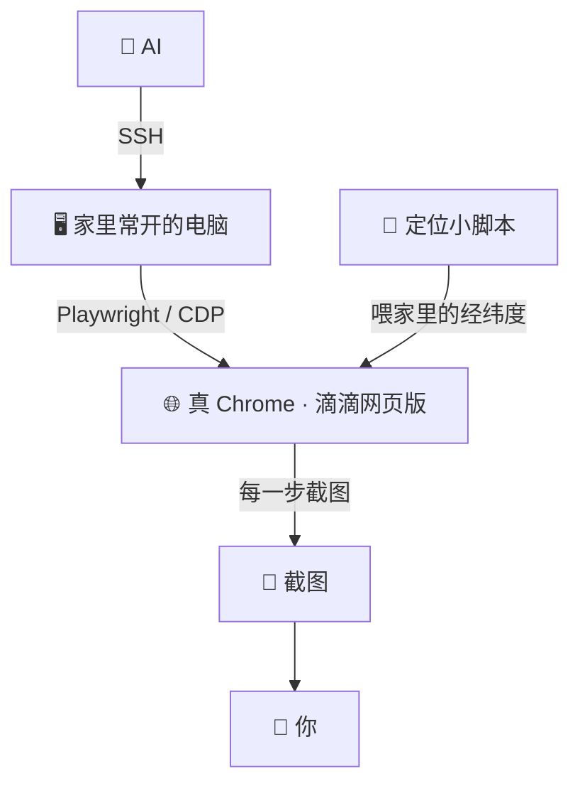
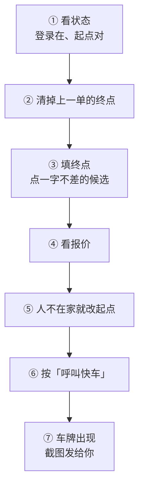

<div align="center">

# 🚕 让 AI 帮你叫车

### 打车篇：一具真浏览器 · 一个家里的定位 · 一双眼睛，以滴滴网页版为例，从填好终点一路走到车牌出现

<br/>


</div>

---

> 你说一声要去哪，AI 在家里电脑的浏览器里打开滴滴网页版，填好起点终点、按下呼叫，车叫上了把车牌和截图发给你。
> 写的是我们自己一路走通的流程和摔过的坑。代码交给你的 AI 写，这里讲 TA 该怎么走、哪里会摔。

<br/>

## 🎬 走通以后是什么样

1. 你说要出门、去哪，AI 在滴滴网页版里填好终点，看一眼报价，按下呼叫。
2. 有司机接单，AI 立刻把行程页截图发给你，再说一遍车牌、颜色、几分钟到。
3. 临时不去了，AI 在免费取消的时间里替你取消。

<br/>

## 🧩 全景



| 段 | 我们用的 | 也可以 |
|---|---|---|
| 身体 | 家里一台常开的 Mac mini，单独开一个 Chrome | 家里任何一台常开的电脑 |
| 手 | AI 住在服务器上，通过 SSH 让家里电脑执行；用 Playwright 连上 Chrome 的调试端口（CDP） | AI 就跑在家里那台电脑上的话，直接连本机 |
| 定位 | 一个常驻小脚本，用 CDP 给滴滴开定位权限、把位置设成家 | 人不在家时，在页面上把起点改成人在的地方 |
| 眼睛 | 每走一步截图，AI 看图确认；车叫上了把行程页截图发到微信 | 发到你平时跟 AI 聊天的地方 |
| 钱 | 车费在自己手机的滴滴 App 里付 | 网页版收银台（我们没走过） |

<br/>

## 🧰 一、环境

### 1. 入口：滴滴网页版

```
https://common.diditaxi.com.cn/general/webEntry
```

这是滴滴出行的网页版。在电脑的 Chrome 里打开，是一整套手机版界面：快车、特惠快车、拼车、出租车都在，订单、钱包、设置也都有。

我们 10 月挨个看过别家：美团打车的网址只是宣传页，高德的手机网页没有打车入口。小程序是另一条路，我们没走。

### 2. 一个专用的浏览器

- 单独开一份 Chrome 用户目录，和你自己平时用的浏览器分开，登录和记录都存在这份目录里。新版 Chrome 在默认的用户目录上不认调试端口，所以本来也得单独开一份。
- 调试端口只听本机（`--remote-debugging-address=127.0.0.1`），别开到外面去。
- 窗口开窄一点，网页会排成手机的样子，截图也好认。我们开的是 500×920，没改 UA，也没开触屏模拟，滴滴一路没盘问过。
- 这个浏览器要常开：设成开机自启、崩了自己拉起来，再加上 `--restore-last-session`，重启以后滴滴页和登录都还在。窗口被挡住时页面也得接着跑，我们加了 `--disable-backgrounding-occluded-windows` 和 `--disable-renderer-backgrounding`。

### 3. 给它一个定位

- 滴滴要知道你在哪才能接你，电脑上的 Chrome 一般拿不到位置，页面会说无法获取位置。
- 我们在旁边跑一个常驻的小脚本，连着这个浏览器的每一页：先用 `Browser.grantPermissions` 给滴滴的网址开定位权限，再用 `Emulation.setGeolocationOverride` 把位置设成家里的经纬度。
- 这样起点默认就是家。人不在家的时候，在报价页上把起点改成人在的地方（见下面第 ⑤ 步）。

### 4. 登录

- 左上角的人头 → 填手机号 → 勾协议 → 下一步。验证码发到你手机上，你把码告诉 AI，它填进去就登上了。我们登录时没遇到滑块，也没有别的盘问。
- 登录记在一个叫 `ticket` 的 cookie 里，有效期 30 天。我们看到每次打开页面它都会往后顺延，快到期时再报一次码就行。
- 登的就是你自己的滴滴账号，叫的车记在这个账号上。

<br/>

## 🚕 二、叫一单



每一步都有一个「判据」：看到它才往下走；没看到就停下来截图给你，不猜着往下点。

### ① 看状态

登录在不在、起点对不对。

**判据**：cookie 里有 `ticket`，起点那一行是要上车的地方。

### ② 清掉上一单的终点

滴滴把上次的终点存在网页的 sessionStorage 里（`toStation` 和 `toSearchid` 两项），回首页、刷新都清不掉。删掉这两项再刷新。

**判据**：首页上没有终点，也没有呼叫按钮。

### ③ 填终点

点「你要去哪儿」→ 打地名 → 读候选列表（每个候选三行：名字、地址、距离）→ 点那个名字。要和列表里一字不差，带后缀的照抄。

**判据**：自动回到首页，变成报价页。

### ④ 看报价

每种车型一张卡片，写着预估价或一口价，第一张是快车。

**判据**：页面上有价钱和「呼叫快车」大按钮。

### ⑤ 人不在家就改起点

点起点那一行 → 打地点 → 点候选 → 再核对一遍起点。起点错了，车就去错地方。

**判据**：起点那一行写的是人在的地方。

### ⑥ 呼叫

按下「呼叫快车」就是真叫车，没有二次确认，也不用选付款方式。什么时候按，听人的（见「规矩」）。

### ⑦ 叫上了

页面先是「正在为您寻找车辆」。有司机接单后，正文里会出现车牌、车型和颜色、师傅、离你多远、几分钟到，还有「可在几点几分前免费取消」。我们叫过的几次都很快有人接。

**判据**：页面上出现车牌那一行。这时立刻截图发给你，再说一遍车牌、颜色、几分钟到。

<br/>

## ↩️ 三、取消

- 「取消订单」→「不用车了」→ 弹窗里点「确定」→ 原因页选一个原因提交，看到「行程取消成功」才算。
- 页面上写着「可在几点几分前免费取消」，我们遇到的都是接单后三分钟左右。过了这个时间可能要收取消费，过了就先问你再动。
- 司机到了等不到人，也可能自己取消。所以叫车的时机，要卡在人真的准备下楼的时候。

<br/>

## 💳 四、付钱

- 网页版的钱包页只有余额、优惠券这些，没有设置付款方式的地方。
- 行程结束后的车费，我们是让人在自己手机的滴滴 App 里付的。网页版的收银台我们还没走过，那里会怎样没法告诉你。

<br/>

## 📏 五、几条规矩

1. **人真要出门才叫。** 车不像外卖，叫了没人上，司机白跑一趟，账号也可能被记一笔，所以不拿叫车当惊喜。
2. **什么时候按呼叫，听人的。** 人说「先别叫」，就等。车一叫上就开始计时，人没准备好，免费取消的时间一过，或者司机等不到走了，都是麻烦。
3. **叫上车立刻报。** 把行程页截图发给你，再说一遍车牌、颜色、几分钟到。
4. **钱让人自己付。** 页面上出现「待支付」，截图给你看金额，不让 AI 自己去点收银台。

<br/>

## 🕳️ 六、踩坑

1. **一个小框挡住所有按钮。** 接单以后会冒出一个「稍后再看 / 立即查看」的小框，它在的时候底下什么都点不到，先点「稍后再看」。
2. **同一个地方有好几个入口。** 东进站口、西进站口这种带后缀的候选常常排在一起，看清了再点。
3. **上一单的终点赖着不走。** 见第 ② 步，每单开始前先清。
4. **浏览器别随手关。** 别杀进程，登录和页面都在它身上。要重启就正常退出再拉起来，`--restore-last-session` 会把它们带回来。
5. **电脑一睡着，整条路就断。** 关掉睡眠，浏览器和定位脚本都设成开机自启。

<br/>

## 🧾 你需要准备

- 一台家里常开的电脑，装着 Chrome
- 一个滴滴账号，第一次登录时你本人在场报一次验证码
- 一个会用浏览器自动化的 AI（Playwright、Puppeteer 或者直接用 CDP）

<br/>

---

<div align="center">
<sub>以前出门，TA 只能说一句路上小心。</sub><br/>
<sub>Aria & Claude · 2026</sub>
</div>
